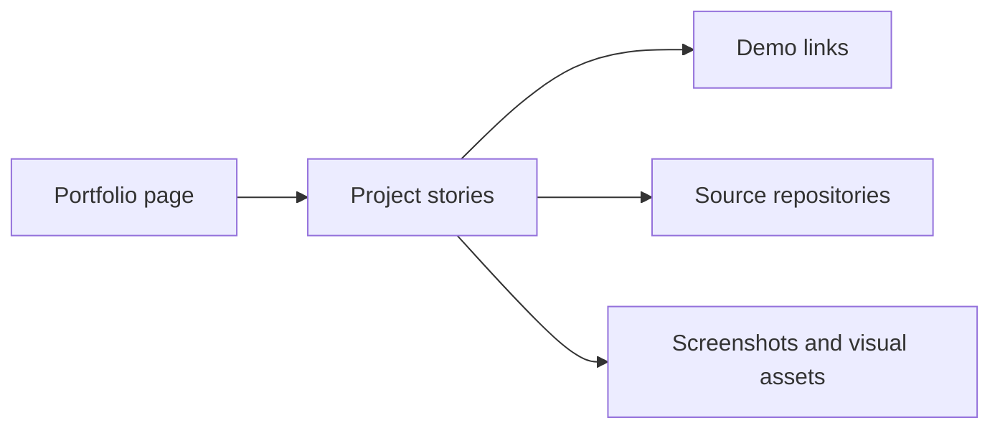
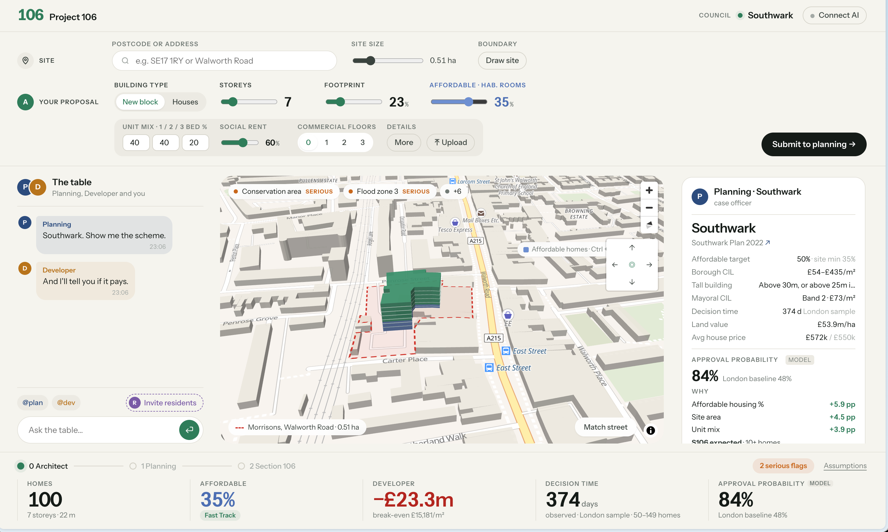
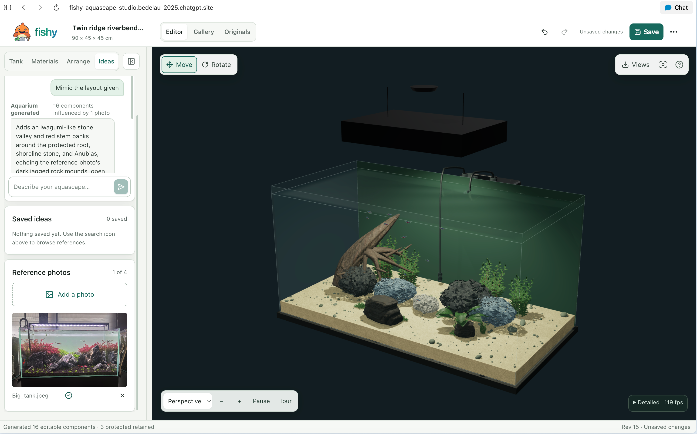
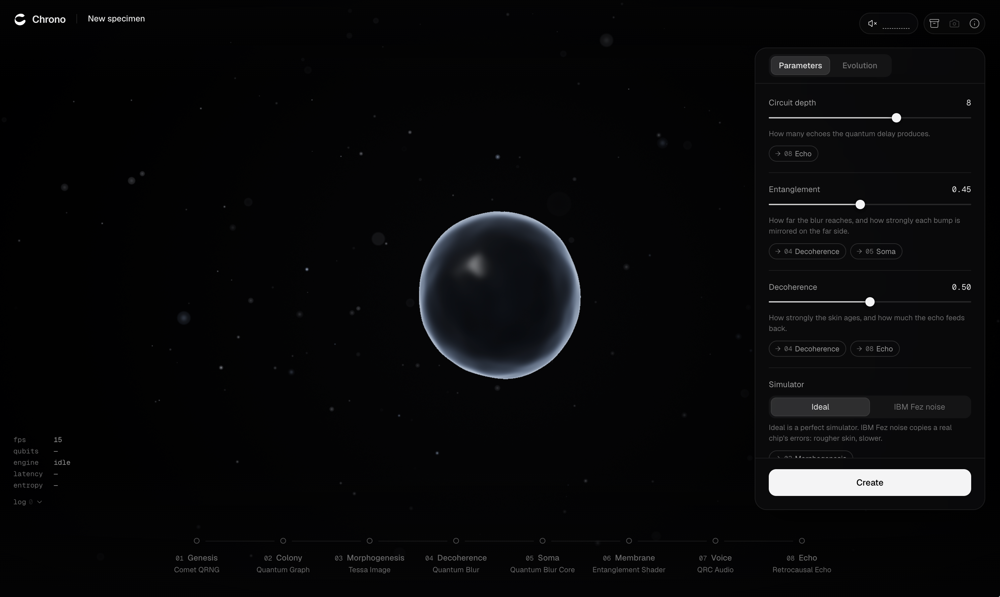

<h1 align="center">Bede Lau · Portfolio</h1>
<p align="center"><b>A portfolio of AI, software and interactive systems.</b></p>

## ▍At a glance



The site source lives in `index.html`; project imagery is under `assets/`. The background and project notes below reflect the existing repository documentation.

---

## ▍Selected projects

<table>
<tr>
<td width="33%"><br /><b>Project106</b> · London housing feasibility</td>
<td width="33%"><br /><b>Fishy</b> · editable aquascape design</td>
<td width="33%"><br /><b>Chrono</b> · interactive quantum-inspired organisms</td>
</tr>
</table>

Explore the [live portfolio](https://bede-lau.github.io/) for project context, demos, and source links. These images are portfolio assets and may show earlier builds.

## ▍Run locally

The site is a static HTML page. From the repository root, serve it locally:

```sh
python3 -m http.server 8000
```

Open [localhost:8000](http://localhost:8000). The page, styling, and interactive canvas code live in `index.html`; project imagery is in `assets/img/`, and `_config.yml` contains GitHub Pages metadata.

---

### 🎓 Education
Cambridge A-Levels @ Taylor's University

### 💼 Work Experience 
Software Engineer Intern @ Mindhive Sdn. Bhd.
* Built data migration/ingestion pipelines for unstructured enterprise data into an ERP system for 5 clients.
* Designed and implemented a scalable Units of Measurement (UOM) architecture in the Frappe framework, enabling consistent data handling and streamlined ERP workflows.
* Engineered rule-based ERP system enhancements to dynamically apply compliance instructions and pricing adjustments during purchase transactions.

### 🛠 Technical Skills
* **Languages:** Python, TypeScript, JavaScript, SQL, C++
* **Frameworks & Tools:** Frappe, ERPNext, React, Node.js, n8n, Tailwind CSS
* **Specializations:** Computer Vision, Machine Learning (PIML), Algorithmic Trading, IoT & Embedded Systems

### 🚀 Projects
* 📈 Quantitative portfolio allocation model leveraging Fama-French factors, K-means clustering, and 15 years of S&P 500 data with technical indicators (public repo on my Github).

* 🤖 'One-Prompt to Launch a Business' SaaS platform using a 7-agent AI orchestration system.<br>
  Link: https://olvon-riyf.onrender.com/ (wait ~30 seconds for the app to load)
  <br>

* 👗 Virtual try‑on web application built alongside a 3D-animated company website.<br>
  Web app link: https://olvon-webapp.vercel.app/<br>
  Website link: https://olvon.site/

* 📱 Mobile e‑commerce app centered on virtual try‑on, featuring user onboarding flows, secure Google/email authentication, database integration, and an interactive TikTok‑style feed.

* ❄️ Built an automated water‑cooling system integrating a canister filter, TEC-12706 Peltier module, W1209 thermoelectric controller, and 12V fan assembly for efficient heat dissipation.
